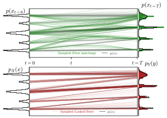

<h1 align="center">Linked Flows</h1>

<p align="center">
    
</p>

Code for `linked_flow` experiments. Built with `jax`, `equinox` and `optax` using exact `scipy` pairing.

## Setup

```bash
bash setup.sh             # uv venv --python 3.12, then uv pip install
source .venv/bin/activate # For NVIDIA CUDA 12 instead: bash setup.sh cuda12
```

Runtime dependencies are pinned in `requirements.txt`. Set `JAX_PLATFORMS=cpu` to select CPU execution.

## Experiments

```bash
python -m scripts.1d.run --profile smoke
python -m scripts.2d.run --profile smoke --datasets two_moons
python -m scripts.nd.run --profile smoke --dimension 16
python -m scripts.mnist.run --profile smoke
```

| Folder | Experiments |
| --- | --- |
| `1d` | Uniform(1,3), Beta(0.5,0.5), three-mode Gaussian mixture |
| `2d` | Checkerboard, circles, eight Gaussians, moons, pinwheel, rings, S-curve, Swiss roll, spirals |
| `nd` | Correlated Gaussian, coupled banana mixture, five-mode Gaussian mixture; configurable dimension |
| `mnist` | Unconditional/conditional U-Net, fixed/repaired LF, random-pair LF, independent FM |

Toy methods are `lf_unpaired`, `lf`, `fm`, `fm_paired`, `lsd`, `psd`, `esd`. The first four run by default (the rest are for flow maps). LF regresses endpoints, FM redraws endpoint (i.e. $t=0$) indices each update (i.e. a conventional FM setup) and paired FM uses the fixed exact assignment. FM saves Heun samples and an additional one-step Euler diagnostic (for comparison with LF) from the same trained velocity. LSD/PSD/ESD use the original stopped-teacher objectives. `--coupling` selects their endpoint coupling, FM coupling is selected explicitly with the method name `fm` or `fm_paired`.

```bash
# One-step flow-map comparison, with the source's L1 LF baseline.
python -m scripts.1d.run --profile smoke --methods lf fm_paired lsd psd esd \
  --loss l1 --coupling paired --clip-norm 1 --learning-rate 0.001 \
  --final-lr-ratio 0.1 --output runs/flow_maps_paired

# Conditional MNIST, re-pairing fresh noise every 10 epochs.
python -m scripts.mnist.run --profile quick --conditional --repair-every 10
python -m scripts.mnist.run --profile quick --conditional --method fm

# Use an existing MNIST download without network access.
python -m scripts.mnist.run --data-dir /path/to/mnist_raw --no-download

# A Gaussian scaling cell; change dimension, pool size, width, or seed.
python -m scripts.nd.run --datasets gaussian --gaussian-kind ar1 \
  --dimension 32 --n-train 5000 --width 256 --methods lf fm
```

Bash launchers in `bash/` group runs by dataset (e.g. 1D, 2D, ... with the chosen dataset). They run locally and sequentially (there is no layer for cluster submissions).

## Files

```text
models/    MLP and MNIST U-Net
lf/        exact pairing and endpoint regression
fm/        straight-path velocity loss and Heun/Euler sampling
fmap/      LSD, PSD, ESD and one-step sampling
metrics/   empirical W1/W2, sliced W2, energy, KS, moment errors
data/      1d/, 2d/, nd/, mnist/ loaders and samplers
scripts/   dataset runners and a shared toy training loop
plots/     dataset plots and plotting entry points
bash/      dataset launchers
```